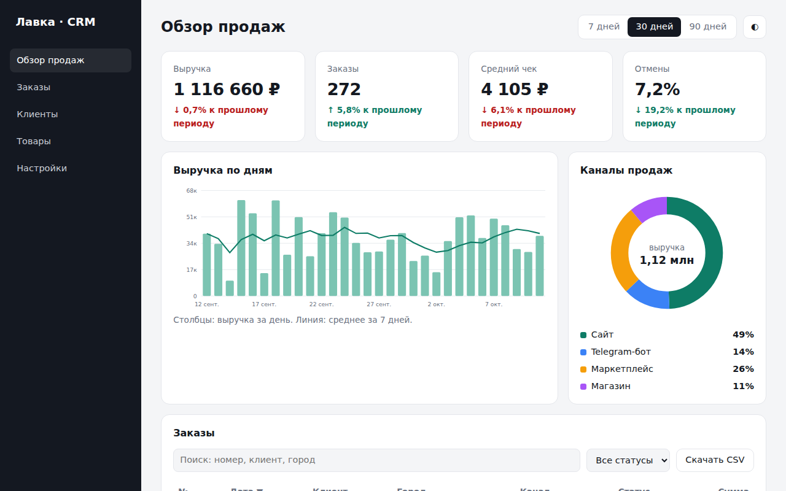

# CRM-дашборд продаж

Админ-панель вымышленного интернет-магазина «Лавка»: KPI за период, график выручки, доли каналов продаж и таблица заказов с карточкой заказа. Графики нарисованы на чистом SVG без библиотек.



## Возможности

**Обзор**
- Период 7, 30 или 90 дней
- KPI: выручка, число заказов, средний чек, доля отмен; у каждого изменение к предыдущему такому же периоду (для отмен рост считается плохим)
- Столбчатый график выручки по дням со скользящим средним за 7 дней и всплывающей подсказкой при наведении
- Кольцевая диаграмма каналов продаж (сайт, Telegram-бот, маркетплейс, магазин) с легендой в процентах
- Отменённые заказы в выручку и графики не входят

**Заказы**
- Поиск по номеру, клиенту и городу
- Фильтр по статусу: новый, оплачен, отправлен, отменён
- Сортировка по любой колонке, повторный клик меняет направление
- Пагинация по 10 заказов
- Боковая карточка заказа по клику или Enter, закрывается кнопкой или Esc; в карточке число заказов этого клиента
- Экспорт отфильтрованных заказов в CSV

**Интерфейс**
- Светлая и тёмная тема, выбор сохраняется в localStorage

## Стек

HTML5, CSS3 (Grid, custom properties), JavaScript без библиотек, SVG, localStorage.

## Как запустить

Сборка не нужна: откройте `index.html` в браузере.

Или через локальный сервер:

```bash
python -m http.server 8000
# затем откройте http://localhost:8000
```

## Настройка

Справочники лежат в начале `<script>` в `index.html`:

- `STATUSES`: статусы заказов и их подписи
- `CHANNELS`: каналы продаж в формате `[id, название, цвет]`
- `NAMES`, `CITIES`: клиенты и города для генерации заказов
- `PER`: число заказов на странице таблицы
- Начальное значение `seed` определяет набор сгенерированных данных

## Структура проекта

```
index.html      # разметка, стили, генерация данных, графики и таблица
screenshot.png  # скриншот для README
LICENSE         # лицензия MIT
```

## Как это устроено

- Данные за 180 дней генерируются детерминированным генератором Парка-Миллера (`seed * 16807 % 2147483647`), поэтому цифры одинаковые при каждой загрузке, а число заказов в день плавно растёт к сегодняшнему дню.
- Периоды считаются окнами `[from, to)`: текущее заканчивается завтрашней полуночью, предыдущее идёт сразу перед ним той же длины.
- График выручки: масштаб по максимуму с запасом 10%, подписи осей в тысячах, подписи дат примерно через каждую седьмую часть периода, скользящее среднее строится по окну до 7 дней.
- Кольцевая диаграмма собрана из окружностей с `stroke-dasharray` и `stroke-dashoffset`, каждая дуга занимает свою долю длины окружности.
- Доступность: у колонок таблицы выставляется `aria-sort`, строки фокусируются с клавиатуры, у графиков `role="img"` и `aria-label`, карточка заказа переключает `aria-hidden`.
- Адаптив: на ширине до 1000px KPI идут в две колонки, до 760px скрывается боковое меню; `prefers-reduced-motion` отключает переходы.

## Идеи для развития

- Подключение к реальному API заказов вместо генератора
- Выбор произвольного диапазона дат
- Смена статуса заказа прямо из карточки

## Лицензия

Концепт-сайт, реального бизнеса за ним нет.

MIT © 2026 whysafe. Telegram: [@yawhysafe](https://t.me/yawhysafe) · Сайт: [whysafe.ru](https://whysafe.ru)
